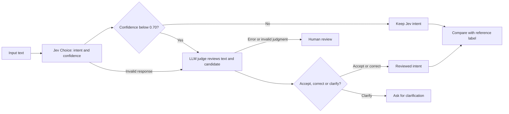

# Clinic intent experiments with Jev and an LLM judge

Live experiment date: October 20, 2026. Jev classified the clinic scheduling dataset successfully, but an LLM escalation step did not improve validation accuracy. Failure-category classification needs clearer category boundaries before it can replace human coding.

## What was tested

1. **Intent classification:** Jev Choice over the sheet's ten scheduling intents, on all 301 inputs.
2. **LLM audit:** `openai/gpt-4.1-mini` reviewed each Jev candidate against the same domain policy, without the reference label, human comments or Jev confidence.
3. **Failure categories:** Jev Choice classified 52 labeled failed traces, ten passing controls, and one additional unlabeled failed trace retained for inspection. The classifier received the original input, predicted intent and classifier explanation. The reference failure category and human comments were withheld.
4. **Confidence escalation:** compare retaining Jev's decision with sending confidence **< 0.70** to the LLM judge. A separate live 12-input probe executed both branches with real confidence scores.
5. **Option order:** reverse the ten Choice options on those 12 probe inputs, and compare with a same-order repeat.

Jev actually served `typesafe/jev-1.13-20260917`. The generative judge served `openai/gpt-4.1-mini`. The source was the user's **AI Evals - Workshop** Google Sheet, snapshotted locally. Source rows, model responses, human comments and credentials are excluded from Git.

The source has 13 conflicting target intents across tabs, one changed input (TEST_227), and one input absent from the judge dataset (TEST_301). The primary comparison therefore uses **286 consistent rows**. All 301 inputs were still classified and remain in the local results. One whitespace-only difference was accepted after trimming. Failure labels come from **LLM as a Judge Dataset**, whose TEST_016 and TEST_032 categories differ from the older Failed Traces tab. The `Solt` spelling is normalized to `Slot`; `Model_Wrong_Simple` receives an explicit fallback definition because the category-definitions tab does not define it.

## Live results

| Method | Consistent references: 286 inputs | Validation partition: 202 inputs |
|---|---:|---:|
| Existing predictions in the sheet | 236/286 (82.5%) | 167/202 (82.7%) |
| Jev intent classifier | 258/286 (90.2%) | 182/202 (90.1%) |
| LLM-reviewed decision on every input | 244/286 (85.3%) | 172/202 (85.1%) |
| Jev with confidence < 0.70 sent to the LLM | 258/286 (90.2%) | 181/202 (89.6%) |

These are **exact matches to the supplied labels**, not a claim that every reference label is correct. An unresolved case stays in the denominator and does not earn a correct match. The all-301 comparison gives Jev 269/301 (89.4%). The original baseline uses a different model/prompt and is historical; this comparison does not isolate a model-only treatment effect.

The 84-row calibration and 202-row validation partitions were deterministically assigned from normalized input hashes before the calls. Identical text stays in one partition, but related paraphrases can cross partitions. The taxonomy was informed by the workshop's existing definitions and examples. This is an exploratory partition, not a pristine independent benchmark or a production approval test. Threshold sweeps use calibration rows only. Validation uses the predeclared 0.70 threshold.

### What confidence gating caught and missed

On the 286 consistent rows:

- 17 went to the LLM judge; 269 retained Jev's decision.
- The gate caught 8 of Jev's 28 errors. **20 errors remained above the threshold.**
- Review corrected 3 labels, introduced 1 wrong label, and left 4 inputs unresolved. Two of those unresolved inputs had matched the reference before review. Overall exact-match accuracy stayed at 258/286.
- On validation alone, 8/202 were escalated. Accuracy moved from 182/202 to 181/202. There is no measured validation improvement from this configuration.
- In the all-input audit, the LLM accepted 13 incorrect Jev labels and changed 5 correct Jev labels to incorrect labels on the consistent subset. An LLM verdict is itself an evaluated prediction, not ground truth.

The 12-case live integration probe intentionally selected six low-confidence and six high-confidence cases. All six low-confidence cases invoked the LLM. All six high-confidence cases made **zero** LLM calls. Three format retries meant nine LLM calls for six reviewed cases. Two cases required clarification and none had an unresolved API/format error. This probe verifies routing, not population accuracy.

Confidence is a statistic derived from Jev's answer distribution. It is not a measured probability of correctness for this workshop. The threshold must be evaluated against domain-specific error costs and labeled examples. [TypeSafe confidence documentation](https://docs.typesafe.ai/confidence)

### Failure-category results

Jev agreed with **24/52 reference failure categories (46.2%)**. It correctly assigned NO_FAILURE to all ten passing controls. The single additional failed trace without a reference category was excluded from category accuracy.

| Reference failure category | Correct / reference examples |
|---|---:|
| False_Unsupported | 12/15 |
| Vague_Utterances | 1/20 |
| Special_Slots_vs_Unblock | 5/5 |
| Multi_Intent_Request | 1/4 |
| Appointment_Management_vs_Slot_Availability | 1/3 |
| Unsupported_vs_Irrelevant | 2/2 |
| Negation_Error | 2/2 |
| Model_Wrong_Simple | 0/1 |

The largest weakness is Vague_Utterances. This category can describe the wording, while False_Unsupported describes the wrong output, so both can apply to the same trace. Some human comments use context unavailable in the model request. Exact agreement is useful for diagnosing this mismatch, but disagreement does not by itself prove that Jev's interpretation is wrong.

An improved next experiment should separate **observed error** (wrong route, dropped action, no observed error) from **contributing condition** (ambiguous wording, negation, missing state). Allow multiple conditions where appropriate, reconcile conflicting human codes, then evaluate on newly reviewed traces. The present implementation intentionally preserves a single primary category to test the supplied scheme.

### Reliability and cost

All Jev responses were valid. The initial LLM audit returned 33 semantically inconsistent JSON contracts, such as CLARIFY paired with a concrete intent. A single format-only retry corrected 32; TEST_229 still failed validation and has no valid LLM judgment. It was high-confidence, so the confidence-only cascade retained Jev while preserving the audit error. This distinction is recorded in the results.

The audit's measured provider cost was **$0.12588751**, including the format retries. The live cascade/order probe cost **$0.003941092**. Including the initial three-case smoke test, the recorded experiment cost was approximately **$0.13**. These are returned usage costs, not a future pricing guarantee. Cached results were reused for format-retry processing; the main audit's cascade metrics are an offline replay of actual model outputs, while the separate probe made real gated calls.

The option-order probe found 2/12 changes versus the original order and 3/12 versus the immediate same-order repeat. The same-order repeat itself changed 1/12 labels, so order alone cannot be credited with every change. This small, ambiguity-enriched sample motivates repeated trials; it does not estimate a general instability rate.

## Where the current evaluation framework is insufficient

| Situation | Why a single label or judge score is insufficient | Evaluation to add |
|---|---|---|
| Multiple actions in one input | TEST_300 receives the correct primary label at confidence 1.0, but that label does not represent both cancellation and rescheduling. | Extract an action list and check completeness; require confirmation before execution. |
| Missing calendar state | Whether opening time means unblocking or creating special hours depends on whether a block exists. An LLM cannot reconstruct absent state reliably. | Supply a frozen calendar fixture; permit clarification when evidence is missing. |
| Patient-specific exceptions | Both models can treat a named patient's request as a supported time-range action despite the policy boundary. | Test explicit negative constraints separately; verify entity scope and authorization before execution. |
| Unclear or inconsistent reference labels | There are 13 target conflicts, two revised failure categories, a spelling alias and one undefined category. | Reconcile labels and version the policy; do not silently pick whichever label improves accuracy. |
| Overlapping failure categories | Vague wording and a false unsupported prediction can both describe the same trace. | Use separate dimensions or multi-label annotation and measure annotator agreement. |
| Confident errors or an imperfect LLM judge | A confidence gate missed 20 errors in the consistent subset; the LLM also endorsed errors and introduced new ones. | Audit high-confidence samples, measure reviewer errors, and keep a human/clarification path. |
| Date arithmetic and counts | Intent recognition does not establish the correct date, timezone, interval, count or conflict check. | Parse/validate dates and compute arithmetic in code against fixed fixtures. |
| Real scheduling outcomes | A correct intent or fluent response does not prove that the intended appointment changed, or that unrelated appointments stayed unchanged. | Assert the before/after calendar or database state and required tool calls. |
| Prompt injection, long context and option order | Content can steer the evaluator; irrelevant context and option ordering can change answers. | Add adversarial traces, order permutations and repeated runs, and minimize irrelevant context. |
| Distribution shift and rare failures | A small curated workshop set does not represent future clinics, languages or failure frequencies. | Track per-intent recall, review new traffic, and maintain independent temporal and adversarial test sets. |

The precise-math, date, literal-reading, adversarial-content, context and option-order limitations are documented by TypeSafe for Jev 1.13. Their suggested division of work puts arithmetic in code and narrows model questions. [Jev 1.13 limitations](https://docs.typesafe.ai/model-jaggedness/jev-1.13)

For agentic tasks, evaluating the transcript and the actual environment outcome catches different failures. Combine model judgments with deterministic checks and human review. [Anthropic's agent evaluation guidance](https://www.anthropic.com/engineering/demystifying-evals-for-ai-agents)

Generative LLM judges also have documented reasoning, position and verbosity biases. This is a reason to evaluate the reviewer against references, rather than assume the second model resolves the first one's mistakes. [MT-Bench and Chatbot Arena study](https://arxiv.org/abs/2306.05685)

## Run the n8n workshop

The workflow is **Clinic Intent Jev with LLM Escalation.json**. A copy is imported in the local n8n instance with both credentials connected. The import and embedded Code nodes were verified. The model calls and confidence routing were run live through the Node harness; the complete uploaded-form execution of this new n8n workflow has not yet been run.

1. Export **Golden Dataset Full** from Google Sheets as CSV.
2. Import the workflow if using another n8n instance. Select the same OpenRouter Header Auth credential in **Call Jev Intent** and **Call LLM Judge**: `Authorization: Bearer <key>`.
3. Execute the workflow, open **Upload Intent CSV**, and upload that file unchanged.
4. Download **clinic_intent_results.csv**. It contains Jev's intent/confidence, whether escalation occurred, the LLM verdict, the final route, and automatic matches to TARGET_INTENT.

`TARGET_INTENT` is carried only for comparison after judging. Neither API request includes it. Empty or unknown labels should be reviewed; the workflow does not reconcile the source-tab label conflicts for you.



This workflow evaluates routing only; it does not cancel appointments or modify a calendar. **Prepare Intent Request** owns the threshold. **Needs LLM Judge** chooses the branch. **Read LLM Judgment** validates the result and **Finalize Decision** records it. In the n8n version, invalid judge content goes directly to HUMAN_REVIEW; the research CLI additionally makes one bounded format-only retry. Both preserve unresolved outcomes rather than silently accepting the initial candidate.

## Reproduce and inspect the full experiment

In the existing checkout, the source snapshot is already in `results/intent-source-2026-10-20.json` and the ignored `.env` has the configured key. Choose a new output directory for every experiment.

```bash
npm ci
npm test

# Audit every Jev output; also calculate the confidence-gated policy by replay.
npm run eval:intents -- \
  --source results/intent-source-2026-10-20.json \
  --output results/clinic-audit-new \
  --mode audit --threshold 0.7

# Actually call the LLM only below the threshold or on a Jev error.
npm run eval:intents -- \
  --source results/intent-source-2026-10-20.json \
  --output results/clinic-cascade-new \
  --mode cascade --threshold 0.7

npm run build:intent-workflow
```

`--dry-run` writes requests without API calls. `--limit 10` makes a small smoke run. `--resume` requires the same source/configuration and reuses exact request caches, preserving raw responses. Invalid outputs remain errors. A nonzero exit code means at least one unresolved model/API response; completed results are still saved.

Per-row timing fields measure the current invocation and include cache access on resumed runs. They should not be used as serving-latency benchmarks. A format retry is a fresh model generation and can change the substantive judgment, so both raw responses are retained in the cache.

For a fresh checkout, export the four source tabs as CSV and build a snapshot:

```bash
node scripts/prepare-intent-source.js \
  --golden golden-full.csv \
  --predictions golden-with-predictions.csv \
  --judge llm-as-a-judge-dataset.csv \
  --failed failed-traces.csv \
  --output results/source.json
```

Implementation: `src/intent-eval.js` defines the taxonomy, request isolation, validation, routing and metrics; `src/intent-eval-cli.js` runs the experiment; `scripts/build-intent-workflow.js` embeds the shared logic into n8n. Forty automated tests cover both the existing social-post project and the added intent pipeline, including threshold boundaries, label isolation, abstentions, malformed responses, format retries, source conflicts and embedded n8n branches.

Local evidence:

- `results/clinic-intents-live-2026-10-20/summary.json`: metrics, thresholds and source issues.
- `results/clinic-intents-live-2026-10-20/intent-results.json`: all predictions and LLM judgments.
- `results/clinic-intents-live-2026-10-20/failure-results.json`: failure-category decisions and controls.
- `results/clinic-intents-live-2026-10-20/cache/`: raw provider responses.
- `results/clinic-cascade-probe-2026-10-20/`: live gating and option-order probe.

Jev Choice is the appropriate primitive for fixed intent/category sets. Its request uses named criteria and returns a selected option, probabilities and confidence. The LLM judge uses OpenRouter's JSON Schema output mode, with application-side consistency checks. [TypeSafe Choice](https://docs.typesafe.ai/primitives/choice), [OpenRouter structured outputs](https://openrouter.ai/docs/guides/features/structured-outputs)
